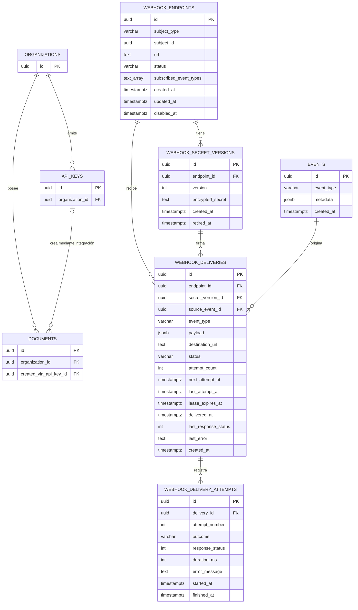

# Módulo Outbound Webhooks

## Objetivo

Notificar a los sistemas de los clientes los eventos de firma de sus documentos, con un `POST`
firmado a una URL que configura cada organización. Es distinto de `src/webhooks`, que **recibe**
webhooks de Stripe, Didit y el indexador.

El primer caso de uso cubre los documentos creados mediante la API de integración
(`documents.created_via_api_key_id IS NOT NULL`). La configuración pertenece a una organización,
pero el modelo admite otros tipos de sujeto sin cambiar las tablas de entregas.

**Estado actual:** existen el contrato (este documento), los enums, las interfaces, las constantes
(`outbound-webhooks.constants.ts`), las entidades, la migración `1784300000094` y la
**configuración del endpoint desde la API de integración** (ver abajo), con sus permisos
(migración `1784300000097`). El registro y el envío de entregas (worker, firma, reintentos) están
descritos abajo y llegan en las siguientes tareas.

## Configuración desde la API de integración

`IntegrationWebhookEndpointController`, con `X-API-Key` y el mismo formato de error que el resto
de la API de integración. La organización sale de la llave; no hay identificador en la ruta.

| Ruta | Permiso | Caso de uso | Respuesta |
| --- | --- | --- | --- |
| `GET /api/v1/integration/webhooks/endpoint` | `WEBHOOK.READ` | `GetWebhookEndpointUseCase` | `200` sin secreto; `404 WEBHOOK_ENDPOINT_NOT_FOUND` |
| `PUT /api/v1/integration/webhooks/endpoint` | `WEBHOOK.MANAGE` | `UpsertWebhookEndpointUseCase` | `201` con `secret` al crear; `200` sin él al actualizar (reactiva uno `DISABLED`) |
| `POST /api/v1/integration/webhooks/endpoint/rotate-secret` | `WEBHOOK.MANAGE` | `RotateWebhookSecretUseCase` | `200` con el `secret` nuevo |
| `DELETE /api/v1/integration/webhooks/endpoint` | `WEBHOOK.MANAGE` | `DisableWebhookEndpointUseCase` | `200` con `status: DISABLED`; idempotente |

- `WEBHOOK.READ` y `WEBHOOK.MANAGE` (alcance `ANY`) son de OWNER y ADMIN y se pueden conceder a
  una API key; los de documentos no dan acceso.
- `WebhookEndpointUrlPolicy` valida la URL al configurar (`422 WEBHOOK_URL_NOT_ALLOWED`, con
  `details.reason`). El envío deberá volver a comprobarla resolviendo el DNS.
- `WebhookSecretCipherService` cifra con AES-256-GCM y la llave `WEBHOOK_SECRET_ENCRYPTION_KEY`
  (32 bytes en base64). Sin ella, crear o rotar responde `503
  WEBHOOK_SECRET_ENCRYPTION_UNAVAILABLE` y el resto del servidor funciona igual.
- En Swagger (`/api/v1/integration/docs`) van bajo el tag **Webhooks**, cuya descripción resume
  este contrato. Los payloads se publican como `callbacks` de `PUT` (esquemas en
  `docs/webhook-payload-v1.models.ts`); la prueba del contrato comprueba que coincidan con los
  ejemplos de este documento y que no traigan campos sensibles.

## Eventos

| Evento | Cuándo ocurre |
| --- | --- |
| `document.collaborator_signed` | Un participante registra su firma. |
| `document.signed` | Todos los firmantes completaron el documento. |
| `document.rejected` | Un firmante rechaza el documento durante la firma. |
| `document.cancelled` | La cancelación del documento se confirma. |

- Cuando firma el último participante se generan **dos eventos independientes**:
  `document.collaborator_signed` y `document.signed`. Cada uno tiene su propio `id` y su propia
  entrega, y el orden de llegada no está garantizado.
- El rechazo del reviewer en el flujo de aprobación previa (`document.approval_rejected`) no es
  `document.rejected` y no se notifica.

## Contrato del payload (versión 1)

Campos comunes:

| Campo | Tipo | Descripción |
| --- | --- | --- |
| `id` | `string` (UUID) | Identificador estable del evento de dominio (`events.id`). Igual en cada reintento. |
| `type` | `string` | Uno de los eventos de arriba. |
| `version` | `1` | Versión del contrato. |
| `occurredAt` | `string` | ISO 8601 UTC con milisegundos. Momento del hecho, no del envío. |
| `data` | `object` | Depende de `type`. |

`data.document.status` es el estado del documento justo después del hecho, con los valores de
`DOCUMENT_STATUS_ENUM` (`PENDING_SIGNATURE`, `SIGNED`, `REJECTED`, `CANCELLED`…). Los
identificadores de participante son los mismos que devuelve la API de integración.

### `document.collaborator_signed`

```json
{
  "id": "5d0b8c62-2f3e-4a7b-9c1d-6e4f8a2b0c13",
  "type": "document.collaborator_signed",
  "version": 1,
  "occurredAt": "2026-11-11T18:30:00.000Z",
  "data": {
    "document": {
      "id": "8f25e9d5-8998-4ec5-9a0e-1421ad48f743",
      "status": "PENDING_SIGNATURE"
    },
    "participant": {
      "id": "77f85c29-0104-4823-8b32-4bc567e88c6a",
      "email": "firmante@empresa.com",
      "status": "SIGNED",
      "signedAt": "2026-11-11T18:30:00.000Z"
    }
  }
}
```

Si es la última firma, `document.status` ya es `SIGNED`.

### `document.signed`

```json
{
  "id": "a3c9e1f4-7b2d-4e8a-b6c0-1d5f9e3a7c28",
  "type": "document.signed",
  "version": 1,
  "occurredAt": "2026-11-11T18:30:00.000Z",
  "data": {
    "document": {
      "id": "8f25e9d5-8998-4ec5-9a0e-1421ad48f743",
      "status": "SIGNED"
    }
  }
}
```

### `document.rejected`

```json
{
  "id": "c7e2a9b1-4f6d-4c3e-8a0b-9d1e5f7a3b64",
  "type": "document.rejected",
  "version": 1,
  "occurredAt": "2026-11-11T19:05:00.000Z",
  "data": {
    "document": {
      "id": "8f25e9d5-8998-4ec5-9a0e-1421ad48f743",
      "status": "REJECTED"
    },
    "participant": {
      "id": "77f85c29-0104-4823-8b32-4bc567e88c6a",
      "email": "firmante@empresa.com",
      "status": "REJECTED",
      "rejectedAt": "2026-11-11T19:05:00.000Z"
    }
  }
}
```

El motivo escrito por el firmante no se publica.

### `document.cancelled`

```json
{
  "id": "e1f4b7c2-9a3d-4e6b-8c0f-2a5d8e1b4c97",
  "type": "document.cancelled",
  "version": 1,
  "occurredAt": "2026-11-12T09:00:00.000Z",
  "data": {
    "document": {
      "id": "8f25e9d5-8998-4ec5-9a0e-1421ad48f743",
      "status": "CANCELLED"
    }
  }
}
```

### Qué nunca viaja en el payload

PDF ni su contenido, URLs prefirmadas, API keys, tokens de firma o de invitación, certificados,
contraseñas, IP, geolocalización, imágenes de firma, evidencia biométrica, nombre del archivo,
motivos escritos de rechazo o cancelación, ni datos de otros participantes.

### Evolución

Agregar un campo opcional es compatible y no cambia `version`: el receptor debe ignorar los campos
que no conoce. Quitar, renombrar o cambiar el tipo de un campo exige `version: 2`.

## Headers y firma

```text
Content-Type: application/json
User-Agent: Firmalo-Webhooks/1.0
X-Signature-Webhook-Id: 3b9d2f61-8c4e-4a7b-9e1d-5f0a2c8b6e43
X-Signature-Event: document.collaborator_signed
X-Signature-Timestamp: 1794421800
X-Signature-Hmac: 9f2c4e…(64 caracteres hexadecimales)
```

| Header | Valor |
| --- | --- |
| `X-Signature-Webhook-Id` | `webhook_deliveries.id`. **No cambia entre reintentos** de la misma entrega. |
| `X-Signature-Event` | Repite `type` para enrutar sin parsear el cuerpo. |
| `X-Signature-Timestamp` | Segundos Unix en decimal, del momento en que se firmó **este intento**. |
| `X-Signature-Hmac` | Firma de este intento, en hexadecimal minúsculo (64 caracteres). |

Fórmula:

```text
X-Signature-Hmac = hex( HMAC-SHA256( secret, timestamp + "." + rawBody ) )
```

- `secret` es el texto completo que se muestra al cliente, `whsec_` incluido, como bytes UTF-8.
- `timestamp` es exactamente el texto de `X-Signature-Timestamp`.
- `rawBody` son los bytes exactos del cuerpo HTTP enviado (JSON en UTF-8, sin BOM). La firma se
  calcula sobre esos mismos bytes; el emisor no vuelve a serializar después de firmar.
- Cada reintento lleva un timestamp nuevo y, por lo tanto, una firma nueva. El cuerpo tiene el
  mismo contenido, pero el orden de sus claves puede variar entre intentos.

### Verificación en el receptor

1. Leer el cuerpo **crudo**, antes de cualquier parser JSON. Verificar sobre un JSON re-serializado
   falla.
2. Rechazar si falta algún header o si `|ahora − timestamp| > 300` segundos (tolerancia
   recomendada: 5 minutos).
3. Calcular la firma con la fórmula y compararla en **tiempo constante** con `X-Signature-Hmac`.
4. Deduplicar por `X-Signature-Webhook-Id` (misma entrega reintentada) o por `id` del payload
   (mismo evento).
5. Responder `2xx` rápido y procesar después.

```ts
import { createHmac, timingSafeEqual } from 'crypto';

function verifyFirmaloWebhook(rawBody: Buffer, headers: Record<string, string>, secret: string): boolean {
  const timestamp = headers['x-signature-timestamp'];
  const received = headers['x-signature-hmac'];
  if (!timestamp || !received) return false;
  if (Math.abs(Date.now() / 1000 - Number(timestamp)) > 300) return false;

  const expected = createHmac('sha256', secret)
    .update(`${timestamp}.`)
    .update(rawBody)
    .digest('hex');
  return received.length === expected.length && timingSafeEqual(Buffer.from(received), Buffer.from(expected));
}
```

## Reglas de entrega

| Regla | Valor |
| --- | --- |
| Confirmación | Cualquier `2xx`. El cuerpo de la respuesta se ignora. |
| Redirecciones | No se siguen; un `3xx` cuenta como fallo. |
| Timeout por intento | 10 s (`WEBHOOK_REQUEST_TIMEOUT_MS`). |
| Reintentos automáticos | Ante `NETWORK_ERROR`, `TIMEOUT` o cualquier respuesta distinta de `2xx`. |
| Calendario | 8 intentos en total: inmediato y luego a 1 min, 5 min, 30 min, 2 h, 5 h, 10 h y 10 h (algo más de 24 h). |
| Agotados | La entrega queda `FAILED`; sólo se reintenta manualmente. |
| Garantía | Al menos una vez. Puede llegar repetida y sin orden. |
| Destino | Sólo `https://` en el puerto 443, a hosts públicos. `WebhookEndpointUrlPolicy` rechaza IPs privadas, loopback, link-local y metadatos de nube, al configurar y otra vez al enviar (resolviendo el DNS). |

## Secretos

- Formato visible: `whsec_<base64url de 32 bytes aleatorios>`. Se muestra **una sola vez**, al crear
  el endpoint o al rotar; `GetWebhookEndpointUseCase` nunca lo devuelve.
- Se guarda cifrado en `webhook_secret_versions.encrypted_secret` por
  `WebhookSecretCipherService` (AES-256-GCM con una llave de servidor; se define en su tarea).
  Firmar exige descifrarlo, así que no puede ser un hash.
- **Rotación:** en una transacción se marca `retired_at` en la versión activa y se crea la
  siguiente. Las entregas nuevas se firman con la nueva. Las ya registradas conservan su
  `secret_version_id` y **siguen firmándose con la versión retirada** hasta terminar; por eso las
  versiones retiradas nunca se borran (FK `RESTRICT`). Tras rotar, el receptor debe aceptar ambos
  secretos hasta que se vacíen las entregas pendientes (24 h como máximo, salvo reintentos manuales).

## Estructura del módulo

```text
src/outbound-webhooks/
├── outbound-webhooks.module.ts
├── outbound-webhooks.constants.ts   Constantes del contrato (headers, tolerancia, reintentos)
├── controllers/                     Configuración, consulta de entregas y reintento manual
├── applications/                    Casos de uso
├── entities/                        Entidades TypeORM
├── enums/                           Sujeto, eventos y estados
├── interfaces/                      Evento interno, payload público, headers y resultado
├── services/                        Suscripción, mapeo, cifrado, firma, URL, HTTP y reintentos
├── workers/                         Procesamiento programado de pendientes
├── dto/                             Validación de solicitudes administrativas
└── metrics/                         Métricas y backlog
```

Hoy existen `entities/`, `enums/`, `interfaces/`, `applications/` (configuración del endpoint),
`controllers/`, `services/` (cifrado y política de URL), `dto/`, `docs/` y `exceptions/`; el resto
se crea con su primera pieza.

### Casos de uso previstos

| Caso de uso | Responsabilidad |
| --- | --- |
| `UpsertWebhookEndpointUseCase` | Crear o actualizar la configuración. Al crear, genera la versión 1 del secreto y la devuelve una vez. |
| `GetWebhookEndpointUseCase` | Consultar la configuración sin revelar el secreto. |
| `DisableWebhookEndpointUseCase` | Desactivar el endpoint. No cancela las entregas ya registradas. |
| `RotateWebhookSecretUseCase` | Retirar la versión activa y crear la siguiente, en una transacción. |
| `RegisterWebhookDeliveryUseCase` | Crear la entrega `PENDING` de forma idempotente (`ON CONFLICT DO NOTHING` sobre `UQ_webhook_deliveries_endpoint_event`). |
| `ProcessPendingWebhookDeliveriesUseCase` | Reclamar con `FOR UPDATE SKIP LOCKED` y procesar las entregas vencidas. |
| `ListWebhookDeliveriesUseCase` | Historial paginado por endpoint. |
| `GetWebhookDeliveryUseCase` | Detalle de una entrega con todos sus intentos. |
| `RetryWebhookDeliveryUseCase` | Reprogramar una entrega `FAILED` (vuelve a `PENDING`, con el mismo `id` y snapshot). |

### Servicios previstos

| Servicio | Responsabilidad |
| --- | --- |
| `OutboundWebhookSubscriptionService` | Decide si un evento interno genera entregas: tipo público, documento de organización creado por API key. |
| `WebhookSubscriptionResolverService` | Resuelve los endpoints `ACTIVE` del sujeto suscritos al tipo. |
| `WebhookEventMapper` | Traduce `OutboundWebhookEvent` a `WebhookPayloadV1`. Es el único punto que decide qué se publica. |
| `WebhookSecretCipherService` | Cifra y descifra secretos. |
| `WebhookSignatureService` | Calcula `X-Signature-Hmac`. |
| `WebhookEndpointUrlPolicy` | Valida destinos permitidos. |
| `WebhookHttpClient` | Envía el `POST` y devuelve un `WebhookDeliveryResult`; nunca lanza por fallos del destino. |
| `WebhookRetryPolicyService` | Clasifica el resultado y calcula `next_attempt_at` o `FAILED`. |
| `WebhookDeliveryWorker` | Ejecuta periódicamente `ProcessPendingWebhookDeliveriesUseCase` (`@nestjs/schedule`). |

## Modelo de datos



### Relación con entidades existentes

| Entidad | Relación |
| --- | --- |
| `organizations` | Primer tipo de sujeto: `subject_type = 'ORGANIZATION'`, `subject_id = organizations.id`. Relación **polimórfica y lógica**, sin FK; la aplicación valida que exista y que quien configura tenga permiso sobre ella. |
| `api_keys` | Identifica la llave con la que se creó el documento. Rotar o revocar la llave no cambia el webhook de la organización. |
| `documents` | `organization_id` determina el sujeto y `created_via_api_key_id` que el documento entra en el alcance inicial. Sin FK desde las entregas: el documento va en el payload. |
| `events` | `webhook_deliveries.source_event_id → events.id`: trazabilidad e idempotencia. |

### Restricciones

| Tabla | Restricción | Para qué |
| --- | --- | --- |
| `webhook_endpoints` | `UQ_webhook_endpoints_subject (subject_type, subject_id)` | Un endpoint por sujeto. Habilitar varios es una migración. |
| | `CHK_…_subject_type`, `CHK_…_status`, `CHK_…_subscribed_event_types` | Valores válidos; al menos un evento suscrito. |
| | `CHK_…_disabled_at` | `disabled_at` presente sólo en `DISABLED`. |
| `webhook_secret_versions` | `FK_…_endpoint_id → webhook_endpoints` | |
| | `UQ_…_endpoint_version (endpoint_id, version)` | Consecutivo por endpoint. |
| | `UQ_…_active (endpoint_id) WHERE retired_at IS NULL` | Como máximo un secreto activo. |
| | `UQ_…_id_endpoint (id, endpoint_id)` | Destino de la FK compuesta. |
| `webhook_deliveries` | `FK_…_endpoint_id → webhook_endpoints` | |
| | `FK_…_secret_version_endpoint (secret_version_id, endpoint_id) → webhook_secret_versions (id, endpoint_id)` | El secreto pertenece al endpoint de la entrega. |
| | `FK_…_source_event_id → events` | Evento de origen. |
| | `UQ_…_endpoint_event (endpoint_id, source_event_id)` | Registro idempotente. |
| | `IDX_…_status_next_attempt (status, next_attempt_at)` | Reclamo del worker. |
| | `IDX_…_endpoint_created_at (endpoint_id, created_at)` | Historial paginado (Postgres recorre el índice hacia atrás para `DESC`). |
| | `CHK_…_delivered_at`, `CHK_…_lease`, `CHK_…_attempt_count`, `CHK_…_status`, `CHK_…_event_type` | Coherencia de estado. |
| `webhook_delivery_attempts` | `FK_…_delivery_id → webhook_deliveries` | |
| | `UQ_…_delivery_attempt (delivery_id, attempt_number)` | Un número por intento. |
| | `CHK_…_finished` | `outcome` y `finished_at` se llenan juntos; ambos `NULL` si el intento quedó interrumpido. |

Todas las FK son `ON DELETE RESTRICT`: lo que se notificó a un cliente no se borra en cascada.
Estados y tipos son `varchar` con `CHECK`, no enums de Postgres; agregar un valor es una migración
que amplía el `CHECK`.

`destination_url`, `payload` y `secret_version_id` son snapshots del registro. Cada entrega se
rastrea hasta su evento (`source_event_id`) y todos sus intentos (`webhook_delivery_attempts`).

## Flujo interno

```text
Cambio de estado del documento (en su transacción)
→ registrar evento durable en events (outbox)
→ publicar evento interno
→ comprobar origen: documento de organización con created_via_api_key_id
→ resolver el endpoint ACTIVE de la organización suscrito al tipo
→ crear webhook_delivery idempotente (snapshot de URL, payload y secreto activo)
→ el worker reclama (DELIVERING + lease), firma y envía el POST
→ registrar webhook_delivery_attempt
→ DELIVERED, RETRY_SCHEDULED o FAILED
```

Recuperación: si el proceso muere durante un intento, la entrega queda `DELIVERING` con el lease
vencido y el intento sin `finished_at`. El siguiente reclamo la toma y abre el intento siguiente.

## Límites actuales y dependencia de OWH-03

- **Sin evento durable de origen.** Hoy los cuatro eventos salen por `emitCollaboratorSigned`,
  `emitSigned`, `emitRejected` y `emitCancelled` de `DocumentEventsProducer`
  (`src/kafka/document-events.producer.ts`): publican directo en Kafka y escriben la fila de
  `events` aparte, sin esperar el resultado y fuera de la transacción del cambio de estado. Si esa
  escritura falla sólo se registra en el log. Además, `metadata` guarda sólo
  `{ documentId, fileName }` (más `collaboratorId` en la firma de un participante), sin
  organización, llave, estado ni fecha. `source_event_id` necesita una fila garantizada y completa.
- **OWH-03** debe llevar `document.collaborator_signed`, `document.signed`, `document.rejected` y
  `document.cancelled` a la outbox transaccional (`OutboxService.enqueue`), con lo que necesita
  `OutboundWebhookEvent`: `organizationId`, `createdViaApiKeyId`, estado del documento y, cuando
  aplica, participante con fecha. Hasta entonces no se puede registrar ninguna entrega.
- Sólo se notifican documentos creados por API key; los de la aplicación web de la misma
  organización no.
- Un endpoint por organización, sin filtros por llave.
- Sin playground, firma de prueba ni evento `ping`; se pueden agregar sin cambiar el contrato.
